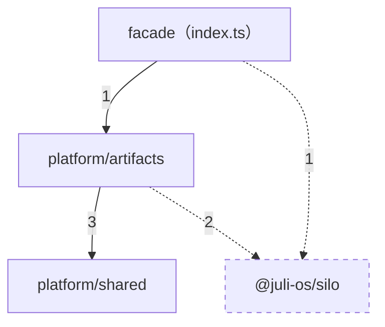

<!-- generated by scripts/gen-docs.mjs — DO NOT EDIT -->
> 本页由生成器产出（npm run docs:gen）：模块依赖由 src/ 相对 import 实测聚合。

# 架构（模块依赖实测）

共 3 个节点、2 条目录级有向边（边上数字 = 实测相对 import 条数；同目录内部依赖不单列；@juli-os/* 外部依赖以虚线呈现）。

## 模块职责

| 模块 | 职责（摘自代表文件头注释） |
| --- | --- |
| `facade（index.ts）` | L2 artifacts layer facade — the only public surface of this layer. |
| `platform/artifacts` | 工件账本（对应 Go lifecycle artifacts 表 + case-inbox 扫描）：行不可变——仅 storage 晋升与 deleted_at（墓碑）两个单向转变，从不 DELETE。 |
| `platform/shared` | 可注入的时间与 ID 生成——测试确定性的根。 |
